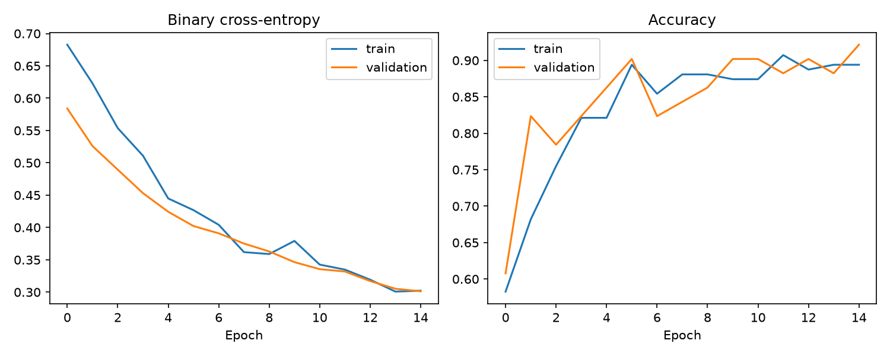
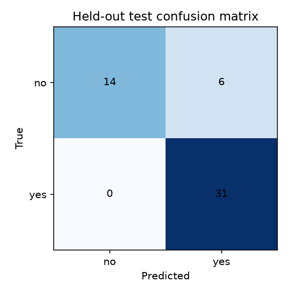
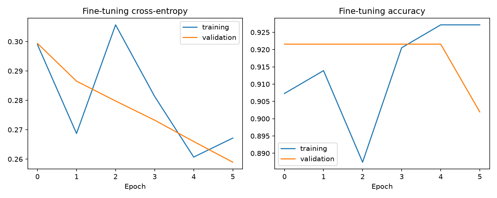

# Brain MRI tumor-presence classification

A small reproducible experiment in **binary image classification**: given an MRI image, predict whether the dataset labels it as **tumor (`yes`)** or **no tumor (`no`)**. It does not segment or locate tumors, and it is **not suitable for clinical use**.

## Result so far: frozen EfficientNetB0 baseline

| Metric | Held-out image test set (n=51) |
|---|---:|
| Accuracy | **88.24% (45/51)** |
| Tumor sensitivity | **100% (31/31)** |
| No-tumor specificity | **70% (14/20)** |
| Tumor precision | **83.78%** |
| Balanced accuracy | **85.0%** |
| ROC-AUC | **0.890** |





These are measurements from a single small image-level test split, not performance on independent patients. All 6 test errors were **false positives**; this doesn't imply the model will never miss a tumor. The test results have already been inspected, so **further model selection must use validation data**, not this test split. An external, patient-separated cohort is needed for an unbiased final comparison.

## Model and experiment

- **Dataset:** [Navoneel Chakrabarty's Brain MRI Images for Brain Tumor Detection (Kaggle)](https://www.kaggle.com/datasets/navoneel/brain-mri-images-for-brain-tumor-detection), 253 `yes`/`no` images. Images are downloaded separately and **not** redistributed here.
- **Split:** 151 training, 51 validation, 51 test images; a fixed random seed of 42. Exact identical images (25 duplicate instances) are grouped within the same split using decoded-pixel hashes. **Patient IDs are unavailable**, so patient overlap and visually similar near-duplicates cannot be ruled out.
- **Model:** ImageNet-pretrained EfficientNetB0, frozen CNN backbone, global average pooling, dropout and a sigmoid classification head.
- **Training:** Adam optimizer, binary cross-entropy, mild data augmentation and early stopping; pixel values remain on 0–255 scale because Keras EfficientNet incorporates its own rescaling.
- **Baseline artifacts:** [metrics.json](results/baseline/metrics.json), learning curves and confusion matrix. These are from a real run, not synthetic or recreated performance.

## Reproduce the baseline

On Python 3.11 (Mac/Linux):

```bash
python3.11 -m venv .venv
source .venv/bin/activate
python -m pip install -r requirements.txt
python -m pytest -q
python run_from_kaggle.py --output-dir outputs/retrain
```

The helper downloads or finds the Kaggle dataset; Keras downloads EfficientNet pretrained weights on first use. Local results and paths are ignored by Git. A repeat run can differ from the archived result depending on environment and hardware.

## Next experiment: fine-tune part of EfficientNetB0

Starting from the **trained** baseline checkpoint and its original train/validation manifests:

```bash
# Copy the old outputs/ directory once to experiments/baseline/ (details in docs/RUN_AND_LEARN.md)
python fine_tune.py --baseline-dir experiments/baseline --output-dir experiments/fine_tuned
```

The script freezes early layers, unfreezes the last 20 layers other than batch normalization, recompiles with a low learning rate of `1e-5`, and reports **validation-only** metrics. It doesn't use the test set for model selection. See [the beginner's guide](docs/RUN_AND_LEARN.md) for every step.

## Tests and limitations

`python -m pytest -q` checks split/duplicate handling, metrics, conflicting labels and error selection. These unit tests do not replace end-to-end validation with MRI data. No accuracy improvement is claimed for fine-tuning until it is actually run and assessed.

This dataset is useful for studying transfer learning, but it is too small and poorly documented for clinical claims. Non-patient-wise splits may inflate metrics; image labels and scan differences must be checked before interpretation. The output score is not a calibrated tumor probability.

## Fine-tuning experiment

The frozen EfficientNetB0 backbone was compared with a model
fine-tuned on its final 20 layers (excluding batch normalization),
using an Adam learning rate of 1e-5.

| Validation metric | Frozen | Fine-tuned |
|---|---:|---:|
| Balanced accuracy | 0.909 | 0.893 |
| Sensitivity | 0.968 | 0.935 |
| Specificity | 0.850 | 0.850 |
| ROC-AUC | 0.977 | 0.976 |

Fine-tuning did not improve balanced accuracy or specificity.
The frozen model was retained as the baseline.



### Data quality observations

Qualitative review of the baseline test errors identified
several no-tumor-labeled scans with visible abnormalities
and possible differences in imaging modality.

These observations raise questions about label reliability,
but do not establish that the labels are incorrect.

The dataset lacks patient identifiers and independently
verified clinical annotations. Results are preliminary,
and this classifier is not suitable for clinical use.
